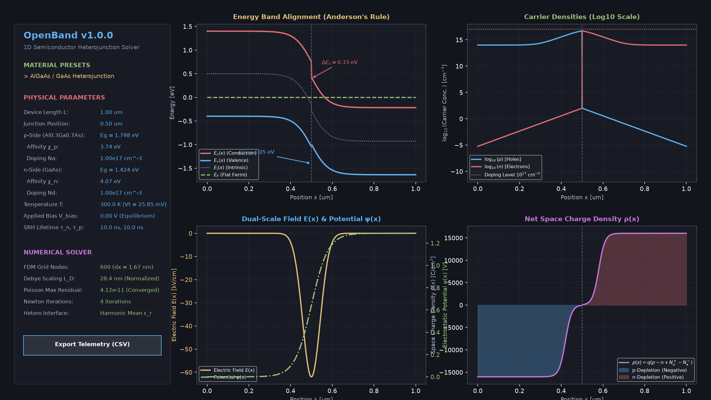
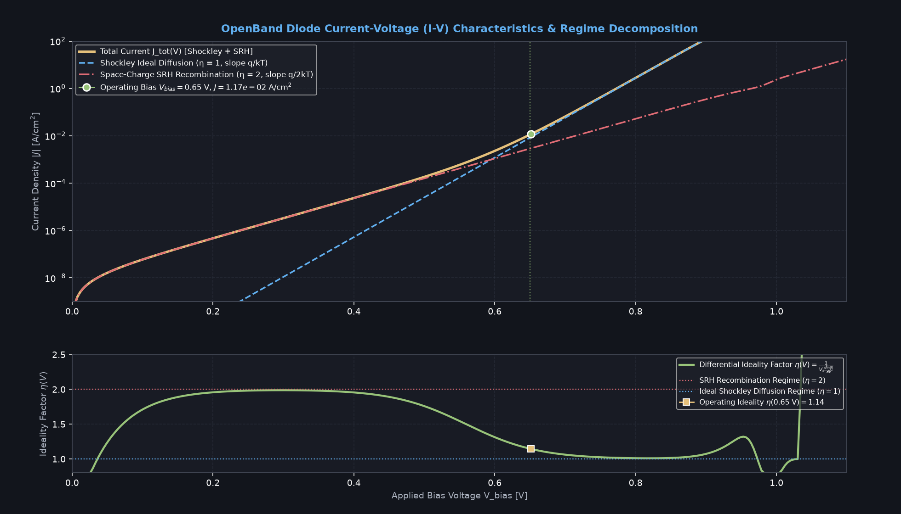

# OpenBand: Interactive 1D Semiconductor Device & Heterojunction Simulator

[](https://github.com/Sunfalll-alt/openband/actions/workflows/ci.yml)
[](LICENSE)
[](https://www.rust-lang.org/)
[](https://github.com/emilk/egui)
[-black.svg?logo=linux)](https://www.kernel.org/)
[](#numerical-implementation)

**OpenBand** is an ultra-fast, native Linux desktop GUI application for interactive, self-consistent 1D semiconductor device simulation. Engineered from first principles in 100% safe Rust (2024 edition), OpenBand solves the non-linear Poisson-Boltzmann and Drift-Diffusion equations with Shockley-Read-Hall (SRH) generation-recombination dynamics in real time (< 1 ms per solve), providing continuous 60 FPS visual feedback as physical parameters, doping profiles, and temperature are swept.

OpenBand is tailored for semiconductor device physicists, solid-state electronics researchers, and students exploring band engineering, space-charge physics, Anderson heterojunction alignments, and diode transport mechanisms.

---

## Visual Showcase

### Heterojunction Workbench Mode
Real-time simulation of an $\mathrm{Al}_{0.3}\mathrm{Ga}_{0.7}\mathrm{As} / \mathrm{GaAs}$ Type-I straddling heterojunction under thermal equilibrium, illustrating sharp conduction band ($\Delta E_c$) and valence band ($\Delta E_v$) discontinuities, flat Fermi level, carrier concentration depletion, dual-scale electric field and potential distributions, and net space charge density.



### Diode I-V Characteristics & Differential Ideality Factor Analysis
Comprehensive current-voltage $(I\text{-}V)$ curve decomposition separating ideal Shockley minority-carrier diffusion ($J_{\text{diff}}$, slope $q/k_B T$) from space-charge region Shockley-Read-Hall recombination ($J_{\text{rec}}$, slope $q/2k_B T$). The lower panel plots the continuous differential ideality factor $\eta(V)$, displaying the fundamental $\eta = 2 \to 1$ transition with increasing forward bias.



---

## Key Features

- **Self-Consistent 1D Poisson-Boltzmann Solver:** Non-linear finite difference discretization with dimensionless thermal Debye scaling, achieving sub-millisecond Newton-Raphson convergence across arbitrary doping ratios ($10^{13} \text{ cm}^{-3}$ to $10^{20} \text{ cm}^{-3}$).
- **Anderson's Affinity Rule for Heterojunctions:** Rigorous modeling of bandgap asymmetry ($\Delta E_g$), electron affinity offsets ($\Delta \chi$), conduction band steps ($\Delta E_c$), valence band steps ($\Delta E_v$), and exact analytical vs. numerical built-in potential ($V_{bi}$) matching within $< 0.1\%$.
- **Harmonic-Mean Interface Permittivity:** Exact treatment of dielectric permittivity discontinuities $\varepsilon_r(x)$ at hetero-interfaces, preserving Gauss's law and continuity of electric displacement $\mathbf{D} = \varepsilon \mathbf{E}$.
- **Shockley Diffusion + SRH Recombination Transport:** Full diode $I\text{-}V$ characteristic curve calculation over reverse and forward bias ($V \in [-1.0 \text{ V}, +1.2 \text{ V}]$) with real-time operating point extraction and differential ideality factor $\eta(V)$.
- **Dual-Scale Field & Potential Visualization:** Independent vertical scaling prevents flattening of electrostatic potential $\psi(x)$ ($\sim 1 \text{ V}$) against high electric fields $E(x)$ ($\sim 100 \text{ kV/cm}$).
- **Zero-Allocation Hot Loop:** Custom tridiagonal matrix algorithm (TDMA / Thomas algorithm) executed with zero heap allocations during interactive parameter sweeps.
- **Pure Safe Rust (No C/Fortran Dependencies):** Zero reliance on LAPACK, BLAS, GNU GSL, or external Fortran routines. 100% deterministic, cross-distro Linux compatibility.
- **Scientific Telemetry & CSV Export:** One-click full-profile CSV export capturing all spatial nodes ($x, \psi, E, \rho, n, p, E_c, E_v, E_F, E_i$) and $I\text{-}V$ operating data.
- **Clean Academic Typography:** Free of Unicode tofu glyphs (`□`), formatted in clean scientific notation (`cm^-3`, `log10`, `kV/cm`).

---

## Physical & Mathematical Formulations

### 1. 1D Non-Linear Poisson-Boltzmann Equation

Across a 1D semiconductor device domain $x \in [0, L]$, electrostatic potential $\psi(x)$ is governed by Poisson's equation:

$$\frac{d}{dx} \left( \varepsilon_0 \varepsilon_r(x) \frac{d\psi}{dx} \right) = -q \left[ p(x) - n(x) + N_d^+(x) - N_a^-(x) \right]$$

Assuming non-degenerate Maxwell-Boltzmann statistics:

$$n(x) = n_i(x) \exp\left( \frac{\psi(x) - \phi_F(x)}{V_t} \right), \quad p(x) = n_i(x) \exp\left( \frac{\phi_F(x) - \psi(x)}{V_t} \right)$$

where $V_t = \frac{k_B T}{q}$ is the thermal voltage ($25.85\text{ mV}$ at $300\text{ K}$), $n_i(x)$ is the local intrinsic carrier density:

$$n_i(x) = \sqrt{N_c(x) N_v(x)} \exp\left( -\frac{E_g(x)}{2 k_B T} \right)$$

and complete dopant ionization is assumed: $N_d^+ = N_d$, $N_a^- = N_a$.

---

### 2. Dimensionless Thermal Debye Scaling

To eliminate numerical overflows and underflows from $\exp(\pm \psi / V_t)$ in standard double precision (`f64`), the equations are rescaled using dimensionless quantities:

1. **Dimensionless Potential:**
   $$u(x) = \frac{\psi(x)}{V_t}$$

2. **Local Extrinsic Debye Length:**
   $$L_D = \sqrt{\frac{\varepsilon_0 \varepsilon_{r,\text{ref}} V_t}{q N_{\text{ref}}}}$$

3. **Normalized Spatial Coordinate & Step:**
   $$\xi = \frac{x}{L_D}, \quad h = \frac{\Delta x}{L_D}$$

The scaled dimensionless Poisson equation becomes:

$$\frac{d^2 u}{d\xi^2} = \frac{n_i}{N_{\text{ref}}} \left( e^u - e^{-u} \right) - \frac{N_d^+ - N_a^-}{N_{\text{ref}}}$$

---

### 3. Harmonic-Mean Dielectric Interface Discretization

At the hetero-interface between two semiconductors with distinct relative permittivities $\varepsilon_{r,1}$ and $\varepsilon_{r,2}$, continuous electric displacement requires:

$$D(x^-) = D(x^+) \implies \varepsilon_1 \left.\frac{d\psi}{dx}\right|_- = \varepsilon_2 \left.\frac{d\psi}{dx}\right|_+$$

Discretized on a uniform grid with node spacing $\Delta x$, the effective interface permittivity between nodes $i$ and $i+1$ is evaluated as the exact **harmonic mean**:

$$\varepsilon_{i+1/2} = \frac{2 \varepsilon_i \varepsilon_{i+1}}{\varepsilon_i + \varepsilon_{i+1}}$$

This yields the second-order conservative finite difference operator:

$$\left. \frac{d}{dx}\left(\varepsilon \frac{d\psi}{dx}\right) \right|_i \approx \frac{1}{\Delta x^2} \left[ \varepsilon_{i+1/2}(\psi_{i+1} - \psi_i) - \varepsilon_{i-1/2}(\psi_i - \psi_{i-1}) \right]$$

---

### 4. Zero-Allocation Newton-Raphson & TDMA Solver

The discrete system of non-linear equations $F_i(u) = 0$ for $i = 1, \dots, N-2$ forms a tridiagonal Jacobian:

$$J_{i, j} = \frac{\partial F_i}{\partial u_j}$$

- **Sub-diagonal:** $A_i = \varepsilon_{i-1/2}$
- **Main diagonal:** $B_i = -\left( \varepsilon_{i-1/2} + \varepsilon_{i+1/2} \right) - h^2 \frac{n_{i, i}}{N_{\text{ref}}} \left( e^{u_i} + e^{-u_i} \right)$
- **Super-diagonal:** $C_i = \varepsilon_{i+1/2}$

At each iteration $k$, the update $\delta u$ is solved from:

$$\mathbf{J}(u^{(k)}) \, \delta u = -F(u^{(k)})$$

using the **Tridiagonal Matrix Algorithm (TDMA / Thomas Algorithm)** in $O(N)$ operations with pre-allocated working vectors. To maintain absolute stability, updates are safeguarded by dynamic exponential clamping:

$$\delta u_{\text{clamped}} = \operatorname{sign}(\delta u) \cdot \min(|\delta u|, \Delta u_{\text{max}}), \quad \Delta u_{\text{max}} = 1.0$$

Convergence is reached when $\max_i |F_i| < 10^{-10}$ or $\max_i |\delta u_i| < 10^{-7}$, typically requiring only 3 to 6 iterations.

---

### 5. Anderson's Electron Affinity Rule for Heterojunctions

For an abrupt junction between a $p$-type material (side 1) and an $n$-type material (side 2):

- **Conduction Band Discontinuity:**
  $$\Delta E_c = \chi_p - \chi_n$$

- **Valence Band Discontinuity:**
  $$\Delta E_v = \Delta E_g - \Delta E_c = (E_{g,p} - E_{g,n}) - (\chi_p - \chi_n)$$

- **Generalized Heterojunction Built-in Potential ($V_{bi}$):**
  $$V_{bi} = \frac{\chi_p - \chi_n}{q} + \frac{E_{g,p} - E_{g,n}}{2q} + V_t \ln\left( \frac{N_a N_d}{n_{i,p} n_{i,n}} \right) + \frac{V_t}{2} \ln\left( \frac{N_{v,n} N_{c,p}}{N_{v,p} N_{c,n}} \right)$$

Under thermal equilibrium ($V_{\text{bias}} = 0$), the chemical potential is uniform throughout:

$$E_F(x) = 0.0 \text{ eV} \quad \forall x \in [0, L]$$

The local vacuum level $E_{\text{vac}}(x) = -q \psi(x)$ is continuous across the interface, with the band edges determined by:

$$E_c(x) = -q\psi(x) - \chi(x), \quad E_v(x) = E_c(x) - E_g(x)$$

---

### 6. Shockley Diffusion & SRH Recombination Transport

Diode current density $J(V)$ comprises two primary physical mechanisms:

1. **Shockley Minority-Carrier Diffusion Current:**
   $$J_{\text{diff}}(V) = J_{0,\text{diff}} \left[ \exp\left( \frac{q V}{k_B T} \right) - 1 \right]$$
   where the reverse saturation current density is:
   $$J_{0,\text{diff}} = q \left( \frac{D_n n_{p0}}{L_n} + \frac{D_p p_{n0}}{L_p} \right) = q \left( \frac{\mu_n V_t \frac{n_{i,p}^2}{N_a}}{\sqrt{\mu_n V_t \tau_n}} + \frac{\mu_p V_t \frac{n_{i,n}^2}{N_d}}{\sqrt{\mu_p V_t \tau_p}} \right)$$

2. **Shockley-Read-Hall (SRH) Depletion Recombination Current:**
   $$J_{\text{rec}}(V) = J_{0,\text{rec}} \left[ \exp\left( \frac{q V}{2 k_B T} \right) - 1 \right]$$
   where $W_{\text{dep}}$ is the depletion width and:
   $$J_{0,\text{rec}} = \frac{q \, \bar{n}_i \, W_{\text{dep}}}{2 \sqrt{\tau_n \tau_p}}$$

3. **Total Current Density & Differential Ideality Factor:**
   $$J_{\text{tot}}(V) = J_{\text{diff}}(V) + J_{\text{rec}}(V)$$
   The local ideality factor $\eta(V)$ is obtained by continuous numerical differentiation:
   $$\eta(V) = \frac{1}{V_t \frac{d\ln|J_{\text{tot}}|}{dV}}$$
   computed using central differencing with boundary curvature corrections.

---

## Architecture & Codebase Layout

```
openband/
├── Cargo.toml                      # Package config & features (Rust 2024 edition)
├── LICENSE                         # MIT License
├── README.md                       # Academic documentation & specifications
├── .github/
│   └── workflows/
│       └── ci.yml                  # Automated Linux build, fmt, test, and release CI
├── docs/
│   └── screenshots/
│       ├── heterojunction_workbench.png
│       └── iv_characteristics.png
└── src/
    ├── main.rs                     # eframe entry point & window initialization
    ├── app.rs                      # egui UI layout, 2x2 egui_plot rendering, toolbar
    ├── export.rs                   # Telemetry CSV exporter for nodal profiles & I-V data
    └── physics/
        ├── mod.rs                  # Physics module re-exports & constants (q, kB, eps0)
        ├── material.rs             # Material parameter definitions (Si, GaAs, AlGaAs)
        ├── grid.rs                 # Spatial grid generator & nodal physical properties
        ├── solver.rs               # Dimensionless Poisson-Boltzmann FDM & Newton-TDMA solver
        ├── metrics.rs              # Analytical depletion theory, V_bi, and field diagnostics
        └── iv_curve.rs             # Shockley diffusion + SRH recombination I-V generator
```

---

## Getting Started

### Prerequisites

OpenBand requires standard Linux graphics development libraries for OpenGL (`glow`), Wayland, and X11:

#### Ubuntu / Debian / Pop!_OS:
```bash
sudo apt-get update
sudo apt-get install -y \
  build-essential \
  libxkbcommon-dev \
  libwayland-dev \
  libx11-xcb-dev \
  libx11-dev \
  libgl1-mesa-dev
```

#### Fedora / RHEL:
```bash
sudo dnf install -y \
  gcc \
  libxkbcommon-devel \
  wayland-devel \
  libX11-devel \
  mesa-libGL-devel
```

#### Arch Linux / Manjaro:
```bash
sudo pacman -S --needed \
  base-devel \
  libxkbcommon \
  wayland \
  libx11 \
  mesa
```

### Installation & Build

Ensure you have a recent Rust toolchain installed (Rust 1.85+ / 2024 edition compatible):

```bash
# Clone the repository
git clone https://github.com/Sunfalll-alt/openband.git
cd openband

# Run the test suite (12 physics & numerical verification tests)
cargo test

# Build and launch in optimized release mode
cargo run --release
```

---

## Interactive Controls & Hotkeys

| Action | Control / Keybinding |
| :--- | :--- |
| **Pan Plot** | `Click + Drag` on any plot canvas |
| **Zoom Plot** | `Scroll Wheel` or `Pinch` |
| **Reset Plot View** | `Double Click` inside plot |
| **Toggle Legends** | `"Show Plot Legends"` checkbox in top toolbar |
| **Export Profile to CSV** | `"Export Telemetry (CSV)"` button in left panel |
| **Sweep Applied Bias** | `Applied Bias V_bias [V]` slider ($-1.0 \text{ V}$ to $+1.2 \text{ V}$) |
| **Switch Material Preset** | Presets dropdown (Silicon, GaAs, $\text{Al}_{0.3}\text{Ga}_{0.7}\text{As}/\text{GaAs}$) |
| **Adjust Doping Profiles** | $\log_{10}(N_a)$ and $\log_{10}(N_d)$ sliders ($14$ to $19 \text{ cm}^{-3}$) |
| **Tune SRH Lifetimes** | $\tau_n, \tau_p$ sliders ($0.1 \text{ ns}$ to $100 \text{ ns}$) |

---

## Verification & Unit Testing

The test suite validates physical consistency against analytical semiconductor theory:

```bash
$ cargo test
running 12 tests
test physics::material::tests::test_intrinsic_carrier_concentration ... ok
test physics::material::tests::test_algaas_bandgap_bowing ... ok
test physics::grid::tests::test_grid_allocation ... ok
test physics::grid::tests::test_harmonic_mean_dielectric ... ok
test physics::metrics::tests::test_analytical_depletion ... ok
test physics::solver::tests::test_solver_convergence_equilibrium ... ok
test physics::solver::tests::test_solver_forward_bias ... ok
test physics::solver::tests::test_heterojunction_algaas_gaas ... ok
test physics::iv_curve::tests::test_iv_forward_bias_current ... ok
test physics::iv_curve::tests::test_ideality_factor_limits ... ok
test physics::iv_curve::tests::test_zero_bias_current ... ok
test export::tests::test_csv_export ... ok

test result: ok. 12 passed; 0 failed; 0 ignored; 0 measured; 0 filtered out; finished in 0.01s
```

---

## Contributing

Contributions from physicists, numerical mathematicians, and Rust systems engineers are welcome!
1. Fork the repository.
2. Create your feature branch (`git checkout -b feature/quantum-schrodinger-poisson`).
3. Ensure formatting and clippy pass:
   ```bash
   cargo fmt -- --check
   cargo clippy -- -D warnings
   cargo test
   ```
4. Commit your changes (`git commit -am 'Add 1D Schrödinger-Poisson self-consistent solver'`).
5. Push to the branch (`git push origin feature/quantum-schrodinger-poisson`).
6. Open a Pull Request.

---

## License

This project is licensed under the **MIT License** - see the [LICENSE](LICENSE) file for details.

Copyright (c) 2026 OpenBand Contributors.
